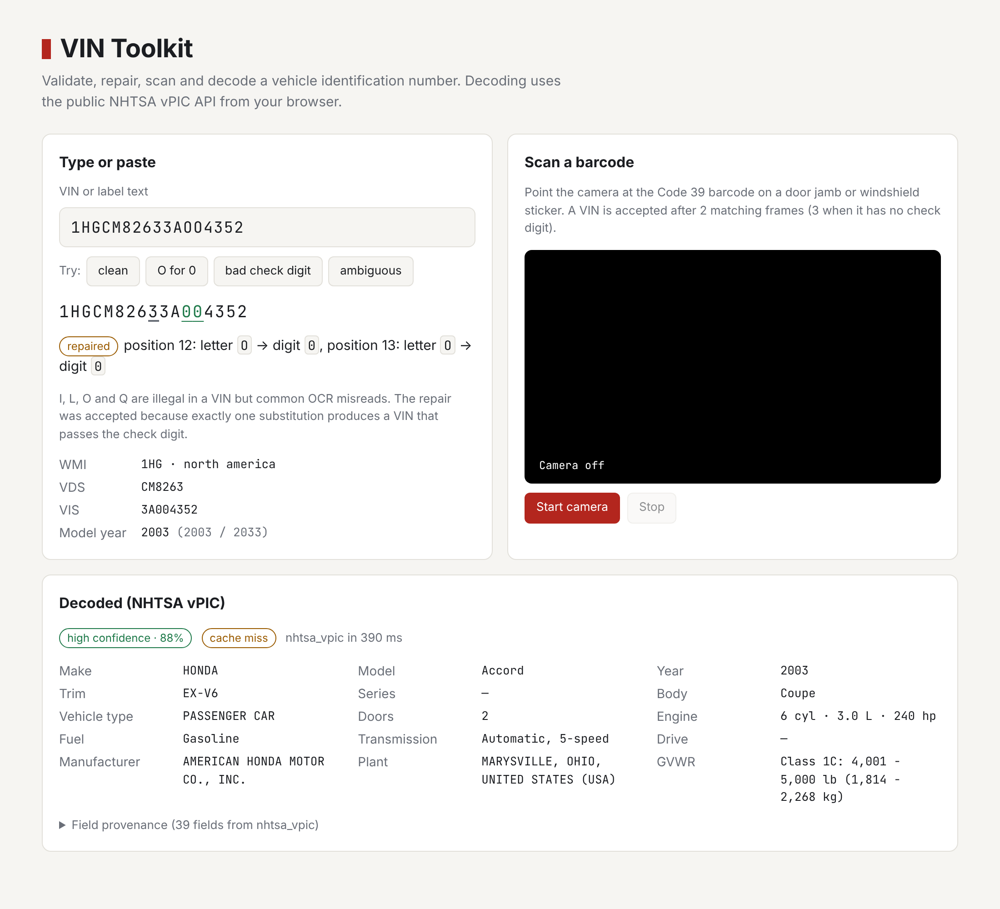
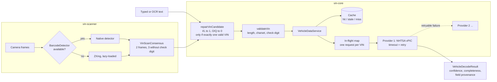

# vin-toolkit

Read a VIN off a door-jamb barcode or a messy OCR string, prove it is the right one, and decode it through NHTSA vPIC without the decoder becoming your outage.



## Why this exists

Every inventory intake in a dealership platform starts with a VIN, and VINs arrive damaged. Phone cameras misread a frame, OCR returns `O` for `0`, and staff paste whole label lines. On the other side, the free government decoder is sometimes slow or down, and gets the same VIN requested by several screens at once. This toolkit is the VIN layer extracted from that production system: strict validation, a repair step that refuses to guess, camera scanning that needs agreement across frames, and a decoder client with timeouts, retries, failover, request coalescing and a stale-while-revalidate cache. A Go port of the decoder service is included and answers with the same JSON contract.

## Architecture



**Packages**

| Path | What it is |
| --- | --- |
| `packages/vin-core` | VIN primitives (`vin.ts`), the vendor-neutral result contract (`types.ts`), the NHTSA vPIC provider (`nhtsa.ts`) and the caching, coalescing, failover service (`service.ts`). No dependencies. |
| `packages/vin-scanner` | Multi-frame consensus (`core.ts`), a browser scanner that prefers the native `BarcodeDetector` and falls back to ZXing (`web.ts`), and an adapter for Expo camera results (`expo.ts`). |
| `go/vin` | Go port of validation, the vPIC client, the service (with `singleflight`), a batch decoder, and a per-key rate limiter. |
| `demo/` | Vite page: camera scanning, a manual box with live repair feedback, and the decoded vPIC data. |
| `cli/vin.ts` | `pnpm vin <VIN>`. |

**Design decisions and tradeoffs**

- **Repair is constrained, not fuzzy.** Only `I`, `L`, `O` and `Q` are touched, because they are illegal in a VIN and are the usual OCR confusions. A candidate with more than three of them is dropped, every combination is checked against the check digit, and the repair is accepted only when exactly one valid VIN comes out across all 17-character windows of the input. Two plausible VINs in one string means `null`, not the first match. Accepting a wrong VIN costs far more than asking the user to rescan.
- **The check digit decides how much evidence is enough.** North American VINs (WMI `1`-`5`) have a mandatory position-9 check digit, so a misread almost always fails validation. Elsewhere it is optional, so the scanner requires three matching frames instead of two. Frames closer than 75 ms apart count as one, and candidates expire after 2 s so a VIN glimpsed earlier cannot combine with a later one.
- **Native first, ZXing on demand.** `BarcodeDetector` is free where it exists (Chrome on Android, macOS). ZXing (~110 KB gzipped) is loaded with dynamic `import()` only when it is needed.
- **The result contract is vendor-neutral.** Callers get `VehicleDecodeResult` with `null` for missing fields (vPIC's `"Not Applicable"` and blanks are normalized), a `completeness` score over eight core fields, a `confidence` that drops when vPIC reports a decode warning, and per-field provenance. A second provider can be added without changing any screen.
- **Failure policy lives in one place.** Each provider attempt gets its own `AbortController` timeout (4 s by default). Only errors marked `retryable` (network failure, timeout, HTTP 5xx and 429) are retried, with exponential backoff, before moving to the next provider. A 4xx or "no data" fails fast.
- **Coalescing before caching.** Concurrent decodes of the same VIN share one in-flight promise (TS) or `singleflight` call (Go), so a page that renders the same vehicle in three widgets makes one request. The Go version detaches the shared call from any one caller's context so a caller that gives up does not fail the others.
- **Stale-while-revalidate windows are long on purpose.** A VIN's factory data does not change. Entries are served as `hit` for 30 days, then as `stale` until 90 days, and only then refetched.
- **Two languages, one contract.** The Go `Result` struct serializes with the same keys and `null`s as the TypeScript type. The tests check this, so a cache written by one runtime can be read by the other.

## Quick start

Needs Node 22+ and pnpm 10 (Go 1.24+ for the Go port).

```bash
pnpm install
pnpm test                    # 28 unit tests, all network calls mocked
pnpm vin "VIN: 1HGCM82633AOO4352"
pnpm dev                     # demo on http://localhost:5173
```

`pnpm vin` repairs the input and decodes it live against vPIC (public, no API key):

```
input        VIN: 1HGCM82633AOO4352
repaired     1HGCM82633A004352  (pos 12: O->0, pos 13: O->0)
vin          1HGCM82633A004352
check digit  valid
region       north_america
model year   2003 (candidates 2003, 2033)
wmi/vds/vis  1HG / CM8263 / 3A004352

vPIC         nhtsa_vpic (cache miss, 552 ms)
make         HONDA
model        Accord
year         2003
trim         EX-V6
body         Coupe
engine       6 cyl, 3.0 L
fuel         Gasoline
drive        —
plant        MARYSVILLE, OHIO, UNITED STATES (USA)
confidence   high (88% of core fields)
```

`pnpm vin --offline <VIN>` skips the network. Bad input exits non-zero with the reason, for example `check_digit (check digit: supplied 3, expected 5)`.

The demo needs a secure context for the camera, and `http://localhost` qualifies. To try it on a phone, put `pnpm dev --host` behind an HTTPS tunnel. The sample buttons show a clean VIN, an OCR-damaged one, a bad check digit, and an ambiguous string that the toolkit refuses to repair.

Go:

```bash
cd go
go test ./...
go run ./cmd/vindecode 1HGCM82633A004352
```

### Using the packages

```ts
import { createVehicleDataService, MemoryVehicleDataCache, NhtsaVpicProvider, repairVinCandidate } from "vin-core";
import { startWebVinScanner } from "vin-scanner/web";

const vehicles = createVehicleDataService({
  providers: [new NhtsaVpicProvider()],
  cache: new MemoryVehicleDataCache(500), // or any { get, set } backed by Redis/Postgres
  timeoutMs: 4_000,
  retries: 1,
});

repairVinCandidate("VIN 1HGCM82633AOO4352")?.vin; // "1HGCM82633A004352"

const scanner = await startWebVinScanner({
  video: document.querySelector("video")!,
  onProgress: (p) => console.log(`${p.matches}/${p.requiredMatches}`),
  onResult: async ({ vin }) => console.log(await vehicles.decode(vin)),
});
```

## Tests

```bash
pnpm test               # vitest: vin-core and vin-scanner
pnpm typecheck          # strict TS, noUncheckedIndexedAccess
cd go && go test -race ./...
```

What they prove:

- **VIN primitives**: check-digit maths, model-year candidates, WMI/VDS/VIS parsing, region rules, and the check-digit policy (`always`, `north_america`, `never`).
- **Repair safety**: `O`/`Q` to `0` and `L`/`I` to `1` fix real misreads. Repair is refused when the result still fails the check digit, when two valid VINs are possible, and when more than three characters would need changing.
- **Consensus**: two separated frames are required, duplicate frames inside 75 ms are rejected, three frames are needed without a check digit, stale candidates expire, and oversized payloads are dropped.
- **vPIC provider** (fetch mocked): field mapping into the contract, `"Not Applicable"` normalized to `null`, HTTP 5xx/429 retryable but 4xx not, aborts reported as `PROVIDER_TIMEOUT`, decode warnings lowering confidence, partial-VIN validation, and calling the browser's `fetch` with the right receiver.
- **Service**: concurrent requests coalesced into one provider call, cache hit, stale and expired handling, LRU eviction, retry then failover to the next provider, no retry on permanent errors, and the per-attempt timeout.
- **Go port** (13 tests, `httptest` server for vPIC): the same vectors as the TS suite, JSON key parity with the TS contract, `singleflight` coalescing, quota consumed only on cache misses, batch decode with duplicates collapsed and per-item errors, the fixed-window limiter, and the in-memory cache.

Every VIN in the tests is either a widely published sample (`1HGBH41JXMN109186`, `1HGCM82633A004352`) or synthetic (`1ZZZZ00Z…` with a computed check digit).

**Camera end-to-end (optional, not in CI).** `scripts/e2e-camera/` renders a Code 39 VIN barcode into a fake webcam clip and drives the demo in headless Chromium. It asserts the scanner accepts the VIN after two frames and the decode panel fills from live vPIC:

```bash
pnpm dev &
python3 scripts/e2e-camera/make_fake_camera.py 1HGCM82633A004352 /tmp/vin.y4m
python3 scripts/e2e-camera/scan_demo.py /tmp/vin.y4m 1HGCM82633A004352
# scan:   Accepted 1HGCM82633A004352 · 90% · 2 frames in 515 ms | engine: ZXing (fallback)
# decode: high confidence · 88% cache miss nhtsa_vpic in 933 ms
```

## What was left out

The production system wrapped this in tenant-aware HTTP handlers (`GET /v1/vin/{vin}`, batch and partial routes) behind its own auth, role checks and per-user quotas. It also kept decodes in a shared Postgres table through generated queries, and had a mobile app wired to the Expo adapter. Those pieces depend on the product's schema and auth, so they are not included. What remains is the interface they plugged into: `VehicleDataCache` / `vin.Cache` for storage, `VehicleDataProvider` / `vin.Provider` for decoders, and the `Allow` hook and `Limiter` for quotas, with in-memory implementations of each.

## License

MIT
